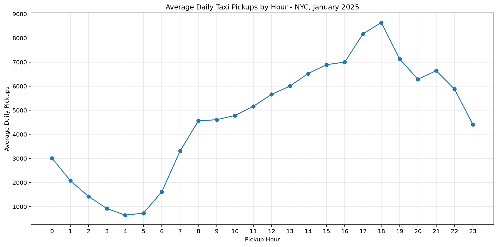

# Hourly Taxi Demand Analysis

## Objective

Analyze how NYC Yellow Taxi pickup demand varies throughout the day using January 2025 trip records.

## Dataset

- **Dataset:** NYC Yellow Taxi Trip Records
- **Period:** January 1–31, 2025
- **Source:** NYC Taxi and Limousine Commission (TLC)
- **Records analyzed:** 3,475,204 January pickups

## Methodology

Pickup timestamps were extracted into hourly groups using DuckDB. The number of trips was counted for each hour across the month.

To make the results easier to interpret, monthly hourly totals were divided by 31 to estimate average daily pickups for each hour.

The SQL query is available in [`03_hourly_taxi_demand.sql`](../sql/03_hourly_taxi_demand.sql).

## Visualization

**Figure 1:** Average daily taxi pickups by hour in NYC, January 2025.

## Key Findings

- Pickup demand is lowest during the early morning hours, particularly around 4 AM.
- Demand begins increasing substantially during the morning.
- Pickup activity generally increases throughout the afternoon.
- The highest demand occurs around 6 PM.
- Demand decreases after the evening peak, although activity remains substantial during the late evening.

## Interpretation

The hourly distribution indicates that taxi demand is not uniform throughout the day.

The afternoon and evening periods account for substantially more pickups than the early morning hours. This pattern may be useful for understanding demand fluctuations and planning taxi availability.

The observed evening peak is consistent with the possibility of commuting and other evening activities contributing to demand. However, this analysis alone cannot establish the causes of the observed pattern.

## Limitations

- The analysis covers only January 2025 and may not represent other months or seasons.
- The dataset contains pickup records, not direct measurements of passenger demand or taxi availability.
- Dividing monthly totals by 31 assumes each hour is represented across all 31 days.
- The analysis describes hourly patterns but does not distinguish weekdays from weekends.

## Conclusion

Hourly taxi pickup activity varies substantially throughout the day. Demand is lowest in the early morning and reaches its highest level around 6 PM.

Further analysis could compare weekday and weekend patterns to determine whether the hourly distribution changes across different types of days.
