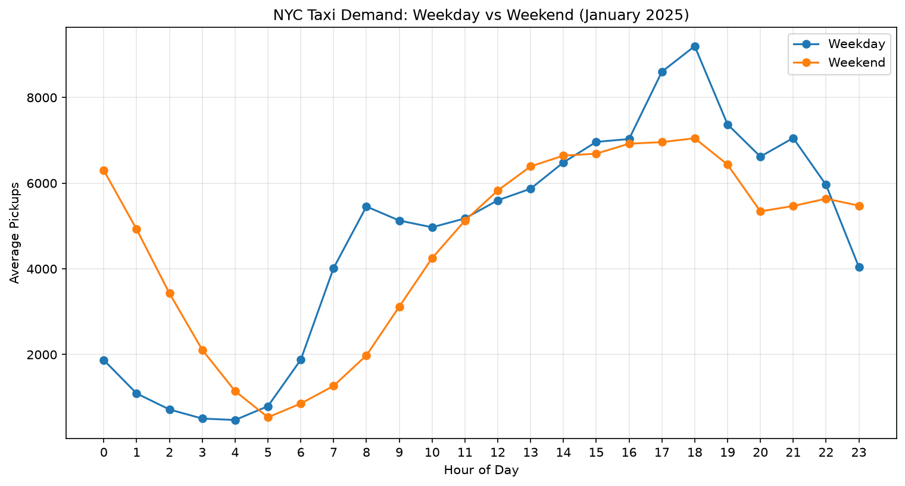

# Weekday vs Weekend Hourly Taxi Demand

## Objective

Compare hourly taxi pickup demand between weekdays and weekends in NYC using January 2025 Yellow Taxi data.

## Methodology

Pickup records were grouped by date, hour, and day type.

The number of pickups was calculated for each date-hour combination and then averaged separately across weekdays and weekends.

January 2025 contains 23 weekdays and 8 weekend days.

## Results

The following table summarizes the main findings.

| Metric | Weekday | Weekend |
|---|---:|---:|
| Midnight pickups/hour | 1,871 | 6,299 |
| 2 AM pickups/hour | 717 | 3,429 |
| 8 AM pickups/hour | 5,455 | 1,980 |
| 12 PM pickups/hour | 5,600 | 5,829 |
| 6 PM pickups/hour | 9,199 | 7,048 |
| 11 PM pickups/hour | 4,043 | 5,476 |

## Key Findings

- Weekday demand is substantially higher during morning commuting hours.
- Weekday demand peaks at 6 PM, averaging 9,199 pickups per hour.
- Weekend demand also peaks at 6 PM, averaging 7,048 pickups per hour.
- Weekend midnight demand averages 6,299 pickups per hour, compared with 1,871 on weekdays.
- Weekend demand is considerably higher during late-night hours.
- Weekday and weekend demand patterns become more similar during the afternoon.

## Interpretation

Taxi demand follows different hourly patterns depending on the day type.

Weekdays show stronger morning and evening activity, while weekends show greater late-night demand and weaker morning activity.

These patterns may be associated with commuting and social activity, although the dataset alone cannot establish the causes.

## Visualization

The visualization compares average hourly pickups across weekdays and weekends.

## Limitations

- The analysis covers January 2025 only.
- Results represent average hourly pickups per day, not monthly totals.
- The analysis identifies patterns but does not establish their causes.

## Concepts Practiced

- Common Table Expressions (CTEs)
- Date and time extraction
- Conditional grouping
- Aggregation across multiple levels
- Average versus total counts
- Comparative analysis
- Data visualization

