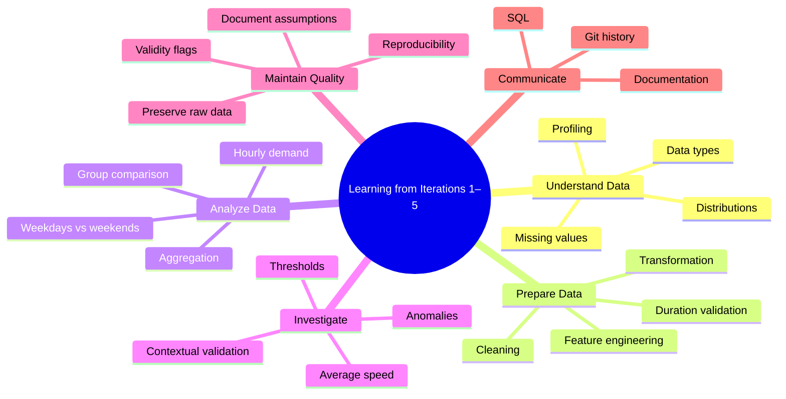

# Learning Review: Iterations 1–5

**Project:** Data Lab — NYC Yellow Taxi Dataset  
**Review period:** Iterations 1–5

## Purpose

This document records the concepts we learned, questions we discussed, misunderstandings we corrected, and connections we developed during the first five iterations.

The individual iteration documents contain the technical work. This document focuses on understanding and retaining the knowledge gained from that work.

---

## 1. Questions We Discussed and What We Learned

### Q1. Why do we profile data before analyzing it?

**What we discussed:**

Before analyzing a dataset, we need to understand its structure, data types, missing values, distributions, and unusual observations.

Our NYC Taxi dataset contained missing passenger counts and extreme distance values. These issues could affect the conclusions of our analysis.

**What I learned:**

Profiling gives us an understanding of the dataset before we trust its results.

It helps us identify potential problems and decide what deserves further investigation.

**Essence:** Understand the data before analyzing it.

### Q2. What is the difference between data cleaning and data transformation?

**What we discussed:**

Data cleaning addresses data-quality problems, while data transformation changes data into a more useful representation.

In our project, excluding invalid-duration records was a cleaning operation. Deriving trip duration in minutes was a transformation.

**What I learned:**

These are different operations, but they can overlap.

A transformation can help us identify invalid data, while cleaning may sometimes involve changing values.

**Essence:** Cleaning improves reliability; transformation improves usability.

### Q3. Why did we derive trip duration?

**What we discussed:**

The original dataset contained pickup and drop-off timestamps.

We calculated trip duration from these timestamps because it was useful for investigating trip validity and analyzing trip behavior.

**What I learned:**

A dataset does not always contain every feature we need.

We can derive new features from existing columns to answer analytical questions.

Trip duration also became useful later when investigating distance anomalies.

**Essence:** Derive useful information from existing data to answer new questions.

### Q4. Why did we compare weekdays and weekends?

**What we discussed:**

We had already examined hourly taxi demand.

Comparing weekdays and weekends allowed us to investigate whether the hourly demand pattern changed depending on the day type.

**What I learned:**

An overall pattern may hide differences between groups.

Comparisons can reveal patterns that are not obvious from a single aggregate.

**Essence:** Comparing groups helps us discover differences that individual summaries can hide.

### Q5. Why is average speed useful for investigating distance anomalies?

**What we discussed:**

A large distance alone does not tell us whether a trip is invalid.

We combined trip distance and trip duration to calculate average speed.

This helped us identify trips whose recorded distances were physically implausible for their durations.

**What I learned:**

One column may not provide enough information to identify a problem.

Combining multiple features can reveal inconsistencies that would otherwise remain hidden.

However, a plausible average speed does not guarantee that the underlying data is correct.

**Essence:** Context from multiple features makes anomaly investigation more meaningful.

### Q6. Why did we choose 100 mph, and why is that threshold not universally valid?

**What we discussed:**

Our investigation revealed extremely high average speeds, including physically implausible values.

We selected 100 mph as a practical threshold for distance-based analysis.

**What I learned:**

A threshold is an analytical decision, not an absolute truth.

Its validity depends on the dataset, context, and purpose of the analysis.

The threshold must be justified and documented.

**Essence:** Data-quality rules depend on context and must be explicitly justified.

### Q7. Why preserve the original dataset instead of deleting anomalous records?

**What we discussed:**

We investigated suspicious distance records and developed a validity rule.

Instead of permanently deleting records from the original dataset, we preserved the original data and used a validity flag.

**What I learned:**

Preserving the original data allows us to reconsider decisions, change thresholds, compare cleaning strategies, and reproduce our analysis.

It also prevents irreversible decisions based on assumptions that might later prove incorrect.

**Essence:** Preserve the original data and make analytical decisions reproducible.

### Q8. Why maintain SQL files, documentation, and Git history?

**What we discussed:**

We maintain SQL files for analytical logic, documentation for methodology and findings, and Git history for tracking changes.

**What I learned:**

These serve different purposes.

SQL tells us what we executed.

Documentation explains why we did it and what we learned.

Git history records how the project evolved.

Together, they make our work understandable and reproducible.

**Essence:** An analysis should be explainable, verifiable, and reproducible.

---

## 2. Questions and Misunderstandings We Corrected

These questions came from reviewing our actual project state.

### Q9. Did our duration-cleaned dataset already exclude negative distances?

**What we discussed:**

The duration-cleaned dataset was created using the `duration_valid` condition.

That condition checked whether the drop-off timestamp was greater than or equal to the pickup timestamp.

It did not explicitly check whether trip distance was negative.

**What I learned:**

A dataset is cleaned only according to the conditions actually applied.

We cannot assume that one cleaning operation automatically handles unrelated data-quality issues.

**Essence:** Always inspect the actual filtering logic before making claims about a dataset.

### Q10. Did we actually create a separate distance-cleaned dataset?

**What we discussed:**

We investigated distance anomalies, calculated average speeds, selected a threshold, and created a `distance_valid` flag.

However, we did not materialize a separate distance-cleaned dataset.

**What I learned:**

Investigating anomalies, creating a validity flag, and creating a cleaned dataset are three different things.

A validity flag identifies which records satisfy a rule.

A separate dataset requires an additional filtering and saving operation.

**Essence:** Distinguish what we investigated, what we implemented, and what we actually saved.

### Q11. Why were the 899 speed anomalies different from the total number of invalid distance records?

**What we discussed:**

The 899 records were trips with positive distance and duration whose average speed exceeded 100 mph.

Our `distance_valid` condition also excluded records with nonpositive distance or duration.

Therefore, the total number of invalid records under that condition was larger.

**What I learned:**

Different filters can exclude records for different reasons.

We must understand exactly what each condition checks before interpreting its results.

**Essence:** A validity flag represents its complete rule, not just one anomaly category.

---

## 3. Connections Between the Concepts

The first five iterations were not independent exercises.

Profiling helped us identify data-quality issues.

Duration analysis allowed us to derive a useful feature and validate timestamps.

Hourly demand analysis showed how aggregation reveals patterns.

Weekday/weekend comparison showed how grouping enables more meaningful comparisons.

Distance anomaly investigation demonstrated how combining features can identify suspicious records.

These connect into a broader analytical process:

**Understand the data → Prepare useful features → Analyze patterns → Investigate anomalies → Document decisions.**

The process is iterative. Findings from one analysis can lead to new questions about data quality or additional features.

---

## 4. Mind Map: What We Learned

---

## 5. Principles to Retain

1. Understand data before trusting it.
2. Cleaning and transformation are related but distinct.
3. Derived features enable new analyses.
4. Aggregation reveals patterns across individual records.
5. Comparisons reveal differences between groups.
6. Anomalies require investigation, not automatic deletion.
7. Thresholds are contextual assumptions.
8. Preserve original data whenever possible.
9. A validity flag is not the same as a cleaned dataset.
10. Document what actually happened, not what we intended to do.
11. Keep analytical logic reproducible.
12. Correct misunderstandings explicitly instead of carrying them forward.

---

## 6. Self-Revision

Before moving forward, I should be able to explain:

- Why profiling is necessary.
- How cleaning differs from transformation.
- Why we derived trip duration.
- What aggregation and group comparison help us discover.
- How average speed helps identify suspicious trips.
- Why 100 mph is a project-specific threshold.
- Why preserving raw data matters.
- The difference between a validity flag and a cleaned dataset.
- How SQL, documentation, and Git contribute to reproducibility.

The objective is to explain these concepts in my own words rather than memorize the written answers.

---

## Final Takeaway

The first five iterations taught us how to reason about a dataset.

The important learning was not simply writing queries or creating visualizations. It was understanding why each operation was necessary, what assumptions it involved, what conclusions it supported, and what limitations remained.

**The goal is to develop an independent analytical mindset: ask meaningful questions, investigate evidence, make justified decisions, and preserve the reasoning behind them.**

